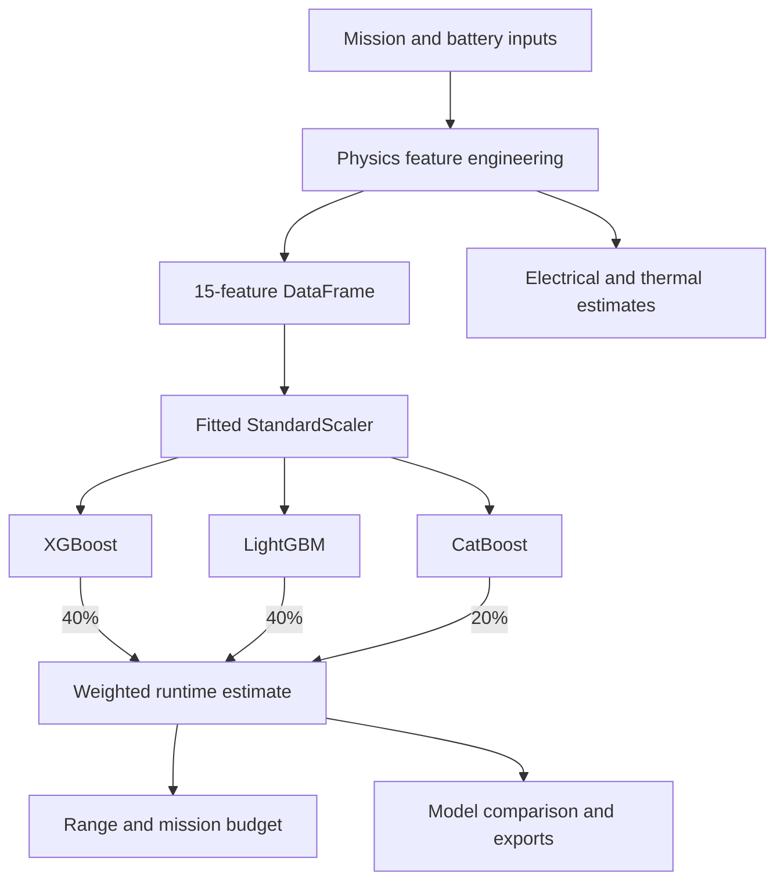

# AMR Hybrid Studio

### Battery runtime estimation and mission planning for autonomous mobile robots

AMR Hybrid Studio combines a physics-based battery simulation with a weighted machine learning ensemble to estimate how long an autonomous mobile robot can operate under a selected mission profile. The Streamlit dashboard lets users change payload, terrain, speed, incline, charge level, battery age, and ambient temperature, then inspect the resulting runtime estimate and mission budget.

The predictor combines **XGBoost, LightGBM, and CatBoost** with weights of **2:2:1**. The dashboard exposes the individual model predictions alongside the final weighted result, making the ensemble's calculation visible.

> **Project scope:** This is a simulation-based machine learning project. The dataset is synthetic, and the results have not been validated on physical robot hardware. Voltage, current, and cell temperature are calculated estimates, not live sensor measurements.

## Project overview

An AMR's operating time depends on more than its starting charge. A heavier payload, a steeper ramp, a rougher surface, or a higher travel speed changes electrical demand. Battery age and temperature also affect usable energy.

This project brings those factors into a single workflow:

1. Generate reproducible synthetic battery and mission data.
2. Engineer electrical and mechanical features from the operating conditions.
3. Train a weighted regression ensemble to predict remaining runtime.
4. Evaluate the saved model on a held-out test set.
5. Use the model in an interactive dashboard for mission exploration and comparison.

The simulated platform is a **65 kg robot with a 24 V, 40 Ah LiFePO₄ battery**, equivalent to **960 Wh nominal energy**, with a **10% discharge floor**.

## Dashboard features

| Workspace | What it provides |
| --- | --- |
| Mission analysis | Runtime, continuous-travel range, electrical load, estimated cell temperature, and a charge-to-runtime curve. |
| Mission budget | Planned mission duration, an adjustable runtime buffer, and the remaining time budget. |
| Sensitivity analysis | Runtime changes across payload, travel speed, or ambient temperature while other inputs remain fixed. |
| Inside the ensemble | Individual model estimates, normalized weights, weighted contributions, and model disagreement. |
| Scenario comparison | Up to six named mission snapshots, side-by-side runtime comparison, and CSV export. |
| Dataset & validation | Dataset filtering, runtime distribution, held-out predictions, residual distribution, and per-model feature importance. |
| Downloads | Current mission, model contributions, saved scenarios, filtered telemetry, and held-out predictions. |

Three starting profiles are included: **Standard delivery**, **Light indoor run**, and **Heavy outdoor run**. Users can modify every profile through the sidebar. Saved scenarios are session-local; CSV exports preserve them after the session ends.

## System architecture



The fitted scaler and ensemble are serialized together in `amr_pipeline.joblib`. The dashboard loads this pipeline for inference; it does not retrain the models when an input changes.

The scaler explicitly returns a NumPy array, so bracketed input labels such as `SoC [%]` are not passed as feature names to the individual estimators. The outer pipeline retains the original feature schema.

## Hybrid model

The ensemble uses `sklearn.ensemble.VotingRegressor` with these settings:

| Model | Configuration | Ensemble weight |
| --- | --- | --- |
| XGBoost | 200 estimators, learning rate 0.08, maximum depth 6 | 2 / 5 = 40% |
| LightGBM | 200 estimators, learning rate 0.08, 31 leaves | 2 / 5 = 40% |
| CatBoost | 300 iterations, learning rate 0.08, depth 6 | 1 / 5 = 20% |

All three models use a random seed of 42. The final runtime prediction is:

```text
Hybrid runtime = 0.40 × XGBoost prediction
               + 0.40 × LightGBM prediction
               + 0.20 × CatBoost prediction
```

The weights are fixed configuration choices, not weights learned during training. Combining the models does not by itself prove an improvement over every individual model; that requires a comparable evaluation of each model on the same held-out data.

Here, “physics-informed” means that simulation equations generate the training data and supply engineered inputs. The project does not use a physics-constrained neural network or a physics-based training loss.

## Dataset and inputs

The training script generates **8,000 synthetic operating points** using NumPy's random generator with seed 42. Noise is added to simulated current, voltage, cell temperature, and runtime to produce variation around the underlying equations.

| User-controlled input | Dashboard range or choices |
| --- | --- |
| Terrain | Smooth epoxy, textured concrete, outdoor asphalt |
| Payload | 0–120 kg |
| Travel speed | 0.3–2.0 m/s |
| Ramp incline | 0°, 2°, 5°, 8°, 12° |
| State of charge | 15–100% |
| Battery age | 10–800 charge cycles |
| Ambient temperature | 15–45 °C |

The training generator samples state of charge from 12–100% and battery age from 10–799 cycles. The dashboard uses the slightly different bounds shown above. Terrain sampling probabilities are 50% smooth epoxy, 35% textured concrete, and 15% outdoor asphalt.

### Model feature schema

The pipeline expects these 15 columns in order:

| # | Feature | Meaning |
| --- | --- | --- |
| 1 | `Terrain_Surface` | Terrain category encoded as 0, 1, or 2 |
| 2 | `SoC [%]` | Starting state of charge |
| 3 | `Voltage [V]` | Estimated loaded battery voltage |
| 4 | `Current [A]` | Estimated current demand |
| 5 | `Payload [kg]` | Carried payload |
| 6 | `Velocity [m/s]` | Commanded travel speed |
| 7 | `Incline [deg]` | Ramp angle |
| 8 | `Ambient_Temp [C]` | Ambient temperature |
| 9 | `Cell_Temp [C]` | Estimated cell temperature |
| 10 | `Battery_Cycles` | Battery age in charge cycles |
| 11 | `Power_Draw [W]` | Voltage × current |
| 12 | `Temp_Rise [C]` | Cell temperature − ambient temperature |
| 13 | `Mechanical_Load_Index` | Mass, speed, and incline proxy |
| 14 | `Available_Energy [Wh]` | Nominal energy above the discharge floor |
| 15 | `Theoretical_Runtime [min]` | Ideal energy-to-power runtime baseline |

The regression target is `Remaining_Runtime [min]`.

## Physics and target construction

The dashboard uses the same deterministic feature equations as the original application. The training generator additionally includes noise. Key relationships are:

```text
Total mass = 65 + payload_kg
Power draw = voltage_V × current_A
Temperature rise = cell_temperature_C − ambient_temperature_C
Mechanical load index = total_mass × speed × (1 + sin(incline))
Available energy = 960 × (SoC − 10) / 100
Theoretical runtime = 60 × available_energy / power_draw
```

The terrain multiplier is 1.00 for smooth epoxy, 1.18 for textured concrete, and 1.38 for outdoor asphalt. Incline is converted to radians before evaluating the sine function.

The synthetic target applies battery-age and temperature effects:

```text
Age-adjusted energy = 960 × (1 − 0.00018 × battery_cycles) × (SoC − 10) / 100
Thermal factor = 0.82 if estimated cell temperature > 42 °C, otherwise 1.00
Target runtime = clip(60 × age-adjusted_energy / power_draw × thermal_factor
                      + runtime_noise, 1, 300)
```

The thermal factor therefore reduces simulated usable capacity by 18% above 42 °C. The dashboard's thermal indicator reports this simulation threshold; it does not issue commands to a real battery management system.

Range and mission budgeting are derived from the runtime prediction:

```text
Continuous-travel range (km) = predicted_runtime_min × 60 × speed_m/s / 1000
Buffered runtime (min) = predicted_runtime_min × (1 − buffer_percent / 100)
Budget remaining (min) = buffered_runtime − planned_mission_duration
```

## Evaluation results

The dataset is split into **6,400 training rows** and **1,600 test rows** using `train_test_split(test_size=0.20, random_state=42)`. The scaler is fitted within the pipeline on the training split.

| Metric | Held-out result |
| --- | ---: |
| Mean absolute error (MAE) | 1.1948 min |
| Root mean squared error (RMSE) | 1.7316 min |
| Coefficient of determination (R²) | 0.998982 |

These results are stored in `metrics.json`. The corresponding row indices, actual values, and predictions are in `test_predictions.csv`. The project checks reproduce the metrics using the bundled model and data.

The test set comes from the same synthetic generator as the training set. These scores measure fit to that simulation; they do not establish performance on real battery telemetry or unseen operating environments. The theoretical-runtime feature closely reflects the equation used to generate the target, which makes the simulated learning task easier than a real deployment problem.

MAE is an average test-set error, not a ± confidence bound for each prediction. Similarly, disagreement between ensemble members is not a calibrated uncertainty interval.

## Technology stack

| Component | Technology |
| --- | --- |
| Runtime | Python 3.13 |
| Dashboard | Streamlit |
| Interactive charts | Plotly |
| Data processing | pandas, NumPy |
| Preprocessing and ensemble | scikit-learn |
| Regressors | XGBoost, LightGBM, CatBoost |
| Model persistence | joblib |

Dependency versions are recorded in `requirements.txt`; the model's training environment is recorded in `metrics.json`.

## Installation and local setup

Download or clone the repository, then open a terminal in its root directory. Use **Python 3.13** and keep the bundled model and data files beside `app.py`.

### Windows PowerShell

```powershell
py -3.13 -m venv .venv
.\.venv\Scripts\python.exe -m pip install -r requirements.txt
.\.venv\Scripts\python.exe -m streamlit run app.py --server.port=8503
```

Alternatively, from the project directory:

```powershell
.\run.ps1
```

The launcher creates the environment if needed, installs the requirements, and starts the app on localhost port 8503.

### macOS or Linux

```bash
python3.13 -m venv .venv
.venv/bin/python -m pip install -r requirements.txt
.venv/bin/python -m streamlit run app.py --server.port=8503
```

Open **http://localhost:8503** in a browser. Run Streamlit from the project root so it discovers `.streamlit/config.toml`.

## Example workflow

1. Load **Standard delivery** from the sidebar.
2. Adjust the terrain, payload, speed, incline, and battery conditions.
3. Review runtime, range, electrical load, and estimated temperature.
4. Enter a planned duration and select a runtime buffer in **Mission analysis**.
5. Open **Inside the ensemble** to inspect each model's estimate and contribution.
6. Save the mission in **Scenario comparison**, change the inputs, and save another plan.
7. Export the comparison or inspect the held-out results in **Dataset & validation**.

Changing the charge-to-runtime curve's starting charge evaluates separate operating scenarios. The curve is not a time-series discharge trace.

## Reproducing training

The complete training workflow is in `train_amr_pipeline_v2.py`:

```powershell
.\.venv\Scripts\python.exe train_amr_pipeline_v2.py
```

On macOS/Linux, use `.venv/bin/python` instead. By default, training writes these files under `ensemble_artifacts/`:

```text
ensemble_artifacts/
├── amr_pipeline.joblib
├── amr_battery_telemetry.csv
├── metrics.json
└── test_predictions.csv
```

The script generates the data, engineers the features, splits the dataset, fits the ensemble, computes evaluation metrics, saves the artifacts, and checks that reloaded-model predictions match the in-memory model.

It refuses to overwrite an existing output artifact. For another training run, select a new directory:

```powershell
.\.venv\Scripts\python.exe train_amr_pipeline_v2.py --output-dir ensemble_artifacts_run2
```

Training does not automatically change the model used by the dashboard. To adopt a new run, back up the existing artifacts, replace all four matching files in the project root together, and restart Streamlit so the cached model is reloaded. Keep the model, dataset, metrics, and prediction file from the same training run.

## Verification

Run the project checks from the repository root:

```powershell
.\.venv\Scripts\python.exe test_dashboard.py
```

The checks cover:

- Model feature names and order.
- Ensemble weights and agreement between weighted member predictions and pipeline output.
- Reproduction of held-out metrics and saved predictions.
- Finite, positive runtime estimates for 16 boundary combinations of payload, speed, charge, and ambient temperature.
- Streamlit rendering, mission preset changes, thermal warnings, scenario save/clear, and empty dataset filtering.
- Feature-equation parity with the original parent application when that file is available locally.

These are regression and interface checks, not exhaustive validation of every operating condition.

## Repository structure

```text
amr-hybrid-dashboard/
├── app.py                       # Streamlit dashboard
├── engine.py                    # Physics features, inference, member contributions
├── train_amr_pipeline_v2.py      # Synthetic data generation and ensemble training
├── test_dashboard.py            # Model and interface checks
├── amr_pipeline.joblib          # Fitted scaler + voting ensemble
├── amr_battery_telemetry.csv     # 8,000 synthetic operating points
├── metrics.json                 # Held-out metrics and training metadata
├── test_predictions.csv         # Held-out actual values and predictions
├── requirements.txt             # Runtime dependencies
├── run.ps1                      # Windows launcher
├── .streamlit/
│   └── config.toml              # Dashboard theme
├── .gitignore                   # Local files excluded from Git
└── README.md
```

## GitHub and hosting

The repository includes the model and data needed to run the application without retraining. Keep `.streamlit/config.toml` in the repository as well. The `.gitignore` excludes the local virtual environment, Python caches, preview logs, local source-hash records, Streamlit secrets, and the default retraining output directory.

Publishing source code on GitHub does not run the dashboard. An interactive deployment needs a Python-capable Streamlit host with:

- Python 3.13 and the dependencies in `requirements.txt`.
- `app.py` as the application entry point.
- Access to the bundled model, data, metrics, and prediction files.

No public deployment URL is included in this repository. GitHub Pages alone cannot execute this Python application.

## Limitations

- **Synthetic training data:** Real sensor noise, battery behavior, and environmental variation may differ substantially from the generator.
- **Simplified physics:** Current, voltage, internal resistance, aging, and temperature follow approximate simulation equations, not a calibrated electrochemical battery model.
- **Constant operating conditions:** Range assumes uninterrupted motion at the selected speed. Stop/start duty cycles, route geometry, regenerative braking, and charging losses are not modeled.
- **Bounded targets:** Training runtimes are clipped to 1–300 minutes. Predictions outside the represented operating distribution require separate validation.
- **No real BMS integration:** The app does not read hardware telemetry, command a robot, or enforce charging or thermal protection.
- **No calibrated uncertainty:** Runtime buffers are user-selected planning margins. They are not statistically derived guarantees.
- **Separate importance scales:** Feature importance is normalized within each selected model. Library-specific definitions differ, so magnitudes should not be compared directly across models.
- **Session-local storage:** Saved scenarios are not persisted to a database.

Only load trusted `.joblib` model files. Serialized Python objects can execute code during loading.

## Future work

Possible extensions include collecting real AMR telemetry, validating across battery packs and routes, adding duty-cycle features, comparing member models on identical test splits, calibrating prediction intervals, and connecting read-only BMS telemetry. These are proposed extensions, not implemented features.
